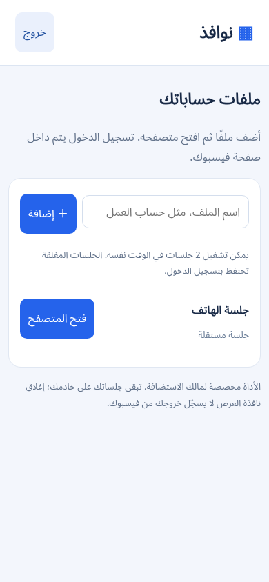
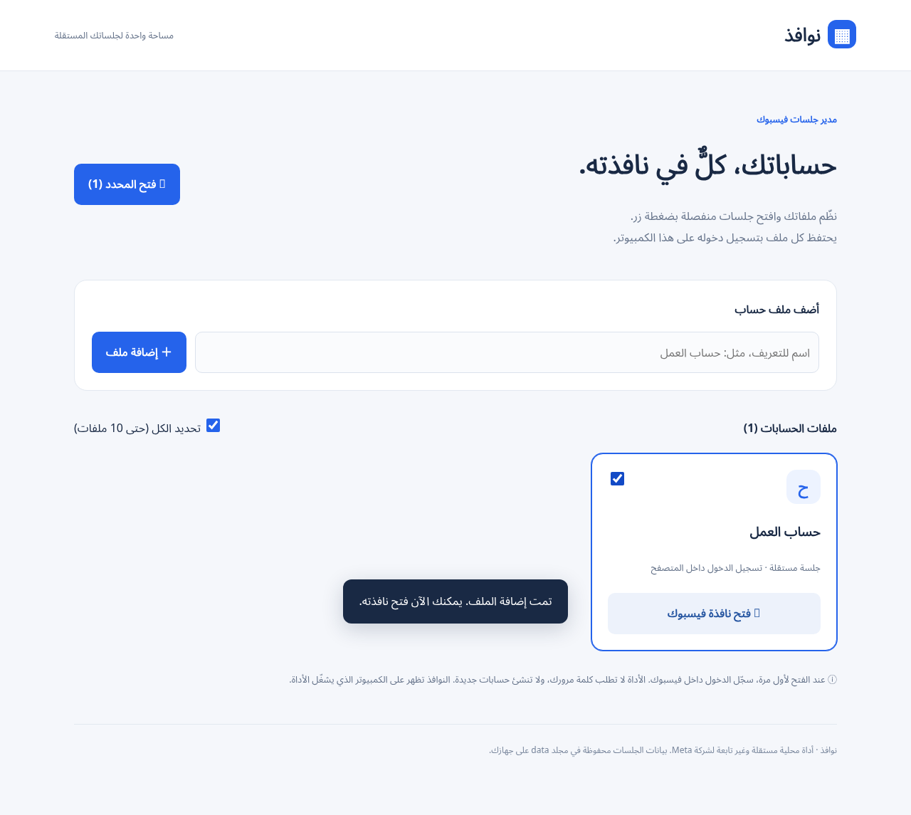

# نوافذ للهاتف — face-nm1

نسخة أندرويد عبر المتصفح: افتح رابط الاستضافة في Chrome وتحكم بمتصفح يعمل على خادمك. لكل ملف جلسة منفصلة محفوظة. هذه أداة لمالك واحد؛ كل من يعرف كلمة مرور الأداة يستطيع التحكم بجميع الجلسات.

## تشغيل داخل GitHub بالحصّة المجانية

[**اضغط هنا لإنشاء Codespace للمشروع**](https://codespaces.new/cvfxcv282-boop/face-nm1)

يعمل المتصفح داخل **GitHub Codespaces**، وتفتحه من Chrome على أندرويد. هذا الخيار يستخدم الحصة المجانية المتاحة لحسابك؛ ليس استضافة مجانية دائمة أو غير محدودة. **GitHub Pages لا يستطيع تشغيل هذا المتصفح.**

1. افتح الرابط أعلاه بحساب GitHub الشخصي، واختر أصغر جهاز متاح (2-core إن ظهر)، ثم **Create codespace**.
2. انتظر تجهيز مساحة العمل. إذا طلب GitHub دفعًا أو لم تتوفر حصة مجانية، توقف ولا تُفعّل استخدامًا مدفوعًا.
3. من قائمة المحرر افتح **Terminal → New Terminal**. على الهاتف قد تحتاج تفعيل «موقع سطح المكتب» في Chrome لإظهار القوائم.
4. اكتب الأمر التالي ثم اضغط إدخال:

   ```sh
   python .devcontainer/start.py
   ```

5. ستظهر كلمة مرور الأداة ورابطها في الطرفية. انسخ كلمة المرور وافتح الرابط، أو افتح تبويب **Ports** واضغط رابط المنفذ **10000**. اترك ظهور المنفذ **Private**؛ افتح الرابط بنفس حساب GitHub.
6. أدخل كلمة مرور الأداة، ثم أضف ملفًا واضغط «فتح المتصفح». اضغط حقل فيسبوك داخل الصورة، واكتب في مربع الإدخال أسفلها ثم اضغط «إرسال».
7. بعد الاستخدام افتح [قائمة Codespaces](https://github.com/codespaces)، واضغط **⋯ → Stop codespace** لتوقيف استهلاك وقت التشغيل. إغلاق تبويب الهاتف وحده لا يوقفه فورًا.

### الحفاظ على الاستخدام المجاني

راجع حصة Codespaces من إعدادات فوترة GitHub، ولا تسمح بتجاوزها باستخدام مدفوع. التخزين يُحسب أيضًا أثناء توقف مساحة العمل. الاحتفاظ بالجلسات يتطلب الاحتفاظ بنفس Codespace؛ حذفه يحذف بيانات الحسابات المحفوظة فيه. لا تُنشئ مساحات جديدة في كل مرة: استأنف المساحة الموجودة من قائمة Codespaces.

ملفان يعملان في الوقت نفسه افتراضيًا، ويمكن حفظ 30 ملفًا. كلمة مرور الأداة وبيانات الجلسات محفوظة في `data/codespaces` المستبعد من Git. لا تنشر هذا المجلد.

ملفات Render السابقة موجودة كخيار استضافة مدفوع اختياري، وليست مطلوبة للتشغيل على GitHub.

## حدود النسخة

- العرض صور متتابعة، وليس بث فيديو أو صوت؛ مناسب للتصفح والنقر وإدخال النص. رفع الملفات والتنزيلات ومكالمات الصوت والفيديو غير مدعومة.
- يقتصر التصفح على نطاقات فيسبوك وموارده. روابط المواقع الخارجية محجوبة.
- قد يطلب فيسبوك تحققًا إضافيًا أو يرفض متصفح الاستضافة. لا تتجاوز الأداة التحقق، ولا تضمن قبول تسجيل الدخول.
- الصورة المعروضة وجلسات الحسابات تعالَج على خادم الاستضافة. استخدم HTTPS، واحمِ كلمة مرور الأداة وقرص الجلسات.
- اختُبرت الواجهة على حجم شاشة هاتف والتحكم بمتصفح حقيقي باستخدام صفحة اختبار. لم يتم اختبار تسجيل الدخول إلى حساب فيسبوك فعلي.

## تشغيل الخادم محليًا للمطورين

```sh
pip install -r requirements.txt
export APP_PASSWORD='choose-a-long-private-password'
export BROWSER_EXECUTABLE=/usr/bin/chromium
export COOKIE_SECURE=0  # للاختبار على localhost فقط؛ على الاستضافة اتركه 1 مع HTTPS
python cloud_app.py
```

أو ابنِ `Dockerfile` وشغّله خلف HTTPS مع `APP_PASSWORD` وقرص بيانات دائم. تشغيل اختبارات التكامل: `python -m unittest discover -s tests -v` مع Chromium في `/usr/bin/chromium` أو متغير `TEST_BROWSER`.



---

## النسخة الأصلية للكمبيوتر

# face-nm1

# نوافذ — إدارة جلسات فيسبوك

واجهة عربية محلية لفتح ملفات متصفح مستقلة لحساباتك الموجودة. يحتفظ كل ملف ببيانات جلسته في مجلد منفصل. تسجيل الدخول يدوي داخل موقع فيسبوك، ولا تخزن الأداة كلمات المرور بنفسها.

## التشغيل

يتطلب Python 3.9 أو أحدث ومتصفح Chrome أو Edge أو Chromium. لا توجد مكتبات Python إضافية.

```sh
python app.py
```

على بعض الأجهزة استخدم `python3 app.py`، وعلى Windows يمكنك استخدام `py app.py`. تفتح الواجهة تلقائيًا، أو افتح http://127.0.0.1:8765 . أضف أسماء الملفات، وحدد ما تريد، ثم اضغط «فتح المحدد». لإيقاف الخادم اضغط Ctrl+C.

الأداة تعمل على Windows وmacOS وLinux مع واجهة رسومية. تظهر النوافذ على جهاز تشغيل الخادم. تشغيلها على استضافة موقع عادية لا يتيح التحكم في متصفح الزائر؛ لذلك شغّل النسخة على الكمبيوتر الذي تريد ظهور النوافذ عليه. GitHub مناسب لحفظ الكود، أما GitHub Pages وحده فلا يشغّل خادم Python.

يقتصر الخادم على localhost ويستخدم رمزًا للتحقق من طلبات التعديل. بيانات `data/sessions` حساسة لأنها تحتوي جلسات المتصفح؛ لا تشاركها ولا ترفعها إلى GitHub. لإزالة ملف نهائيًا أغلق الأداة والنوافذ أولًا ثم احذف بياناته محليًا. الحد الأقصى 30 ملفًا و10 نوافذ لكل طلب فتح.

إرسال طلب فتح النافذة لا يعني نجاح تسجيل الدخول؛ فيسبوك قد يطلب التحقق المعتاد. لا تتضمن الأداة إنشاء حسابات أو تجاوز التحقق.



